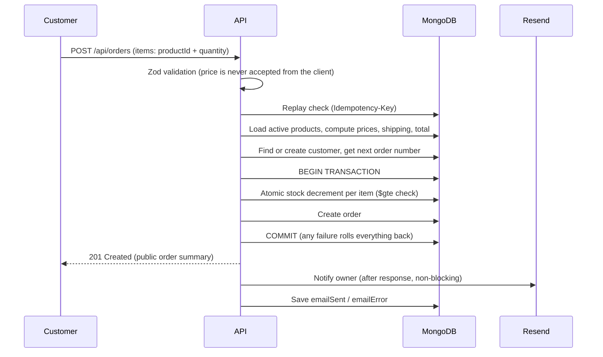
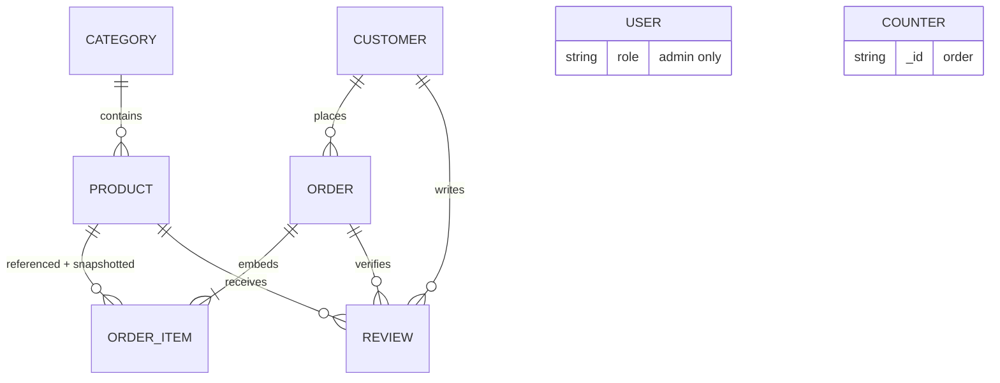

# Lumira Skincare — E-commerce REST API


Production-style backend for a single-brand skincare store. Customers browse and check out as guests (cash on delivery), the owner receives an email for every order and confirms it by phone, and an admin dashboard manages products, orders, reviews and statistics.

The project focuses on the problems that make real e-commerce backends hard: **overselling, duplicate orders, price tampering, safe guest tracking, and secure admin authentication.**

---

## Table of Contents

- [Features](#features)
- [Tech Stack](#tech-stack)
- [Architecture](#architecture)
- [Data Model](#data-model)
- [Getting Started](#getting-started)
- [Environment Variables](#environment-variables)
- [API Conventions](#api-conventions)
- [API Reference](#api-reference)
  - [Health](#health)
  - [Authentication](#authentication)
  - [Categories](#categories)
  - [Products](#products)
  - [Orders (Public)](#orders-public)
  - [Reviews (Public)](#reviews-public)
  - [Admin: Orders](#admin-orders)
  - [Admin: Reviews](#admin-reviews)
  - [Admin: Dashboard Statistics](#admin-dashboard-statistics)
- [Business Rules](#business-rules)
- [Security](#security)
- [Design Decisions](#design-decisions)
- [Testing](#testing)
- [Deployment Notes](#deployment-notes)
- [Known Limitations and Roadmap](#known-limitations-and-roadmap)
- [Author](#author)

---

## Features

**Storefront (public)**
- Categories and products with filtering, search, sorting and pagination
- Featured products, product detail by slug, approved reviews with rating summary
- Guest checkout (cash on delivery), no customer accounts
- Order tracking with `orderNumber` + `email`
- Verified-purchase reviews (delivered orders only)

**Admin**
- Secure login with an httpOnly cookie, logout invalidates the token everywhere
- Product and category management (images uploaded to Cloudinary)
- Atomic stock updates, soft delete
- Order list with filters, status workflow, automatic stock restore on cancel
- Review moderation with automatic product rating recalculation
- Dashboard: overview, sales history, top products, unsold products, low stock

**Engineering**
- MongoDB transactions for checkout (stock decrement + order creation succeed or fail together)
- Idempotent checkout (`Idempotency-Key`) so double clicks never create duplicate orders
- Atomic order-number counter (`LUM-0001`, `LUM-0002`, ...)
- Owner notification email through Resend, sent after the order is committed
- Strict Zod validation, rate limiting, centralized error handling

---

## Tech Stack

| Area | Technology |
|---|---|
| Runtime | Node.js (ES modules) |
| Framework | Express 5 |
| Database | MongoDB Atlas, Mongoose |
| Validation | Zod |
| Auth | JWT in an httpOnly cookie, bcrypt, `tokenVersion` revocation |
| Images | Multer + Cloudinary |
| Email | Resend |
| Security | helmet, cors, express-rate-limit |
| Utilities | morgan, compression, cookie-parser, dotenv, nodemon |

---

## Architecture

```
Request
  → Middleware (helmet, cors, rate limit, body parsers, zod validate, protect/adminOnly)
  → Route
  → Controller        (thin: reads validated input, sends the response)
  → Service           (business logic: pricing, stock, transactions, email)
  → Model (Mongoose)  (schema rules, indexes, hooks)
  → MongoDB

Any error → centralized errorHandler → consistent JSON error
```

### Project structure

```
backend/
├── src/
│   ├── app.js                 # Express app (middleware + routes), no server start
│   ├── server.js              # DB connection, listen, graceful shutdown
│   ├── config/                # db, store settings (shipping, timezone), email
│   ├── constants/             # order statuses, status transitions, limits
│   ├── controller/            # request/response handling
│   ├── services/              # order, review, stats, email logic
│   ├── model/                 # User, Customer, Category, Product, Order, Review, Counter
│   ├── routes/                # public + admin routers
│   ├── middlewares/           # auth, validation, rate limiters, error handler, noStore
│   ├── validation/            # Zod schemas
│   ├── utils/                 # ApiError, asyncHandler, token helpers, escapeHtml
│   └── seed/                  # admin and product seed scripts
├── .env.example
└── package.json
```

### Checkout flow



---

## Data Model



| Model | Purpose |
|---|---|
| **User** | Admin account only. Created by seed script, no public registration. Password is hashed (bcrypt) and `select: false`. `tokenVersion` revokes tokens. |
| **Customer** | Guest buyer record (name, email, phone). No password, no login. |
| **Category** | Product grouping with a unique slug. |
| **Product** | Price, optional discount price, SKU, stock, skin types, ingredients, images, `isActive`, `isFeatured`, `ratingAverage`, `ratingCount`. |
| **Order** | Customer reference + customer snapshot, shipping address, embedded items (product reference **and** snapshot of name, slug, SKU, image, price), totals, status, status history, email status. |
| **Review** | Product, customer and order references, rating, comment, `isApproved`, `isVerifiedPurchase`. |
| **Counter** | Atomic sequence used for order numbers. |

**Reference vs snapshot.** Order items keep a reference to the product (for analytics such as trending and unsold products) and a snapshot of the data at purchase time (so old orders stay correct when a product's price or name changes later).

There is no Cart model (the cart lives in the frontend) and no Dashboard model (statistics are derived with aggregation pipelines).

---

## Getting Started

### Prerequisites

- Node.js 20 or newer
- A MongoDB **Atlas** cluster (transactions require a replica set; Atlas provides one, a standalone local MongoDB does not)
- Cloudinary account
- Resend account and API key

### Installation

```bash
git clone https://github.com/Ahsan-Mudassar/Lumira-skincare-backend.git
cd Lumira-skincare-backend/backend
npm install
cp .env.example .env      # then fill in the values
```

### Seed the database

```bash
npm run seed:admin        # creates the admin user and the order counter (idempotent)
npm run seed:products     # categories + products (blocked when NODE_ENV=production)
```

### Run

```bash
npm run dev               # nodemon
npm start                 # production
```

The API is available at `http://localhost:5000/api` and the health check at `GET /api/health`.

---

## Environment Variables

| Variable | Required | Description |
|---|---|---|
| `NODE_ENV` | no | `development` or `production` (production enables secure cookies, hides 5xx details, requires email config) |
| `PORT` | no | Server port (default `5000`) |
| `MONGO_URI` | yes | MongoDB Atlas connection string |
| `CLIENT_URL` | yes | Exact frontend origin allowed by CORS (e.g. `http://localhost:5173`) |
| `JWT_SECRET` | yes | Random string, at least 32 characters |
| `JWT_EXPIRES_IN_HOURS` | no | Session length in hours (default `24`) |
| `COOKIE_SAMESITE` | no | `lax` (default), `strict` or `none` |
| `ADMIN_NAME` | no | Admin display name for the seed script |
| `ADMIN_EMAIL` | yes (seed) | Admin login email |
| `ADMIN_PASSWORD` | yes (seed) | Admin password (8+ characters) |
| `CLOUDINARY_CLOUD_NAME` | yes | Cloudinary cloud name |
| `CLOUDINARY_API_KEY` | yes | Cloudinary API key |
| `CLOUDINARY_API_SECRET` | yes | Cloudinary API secret |
| `RESEND_API_KEY` | yes in production | Resend API key (sending access) |
| `EMAIL_FROM` | yes in production | Sender, e.g. `Lumira Orders <orders@your-domain.com>` |
| `ORDER_NOTIFY_EMAIL` | yes in production | Owner email that receives new-order notifications |
| `SHIPPING_FEE` | no | Flat shipping fee in PKR (default `250`) |
| `FREE_SHIPPING_THRESHOLD` | no | Subtotal at or above which shipping is free (default `3000`, `0` disables) |
| `LOW_STOCK_THRESHOLD` | no | Stock level considered low (default `5`) |

> Never commit `.env`. The server validates required variables at startup and refuses to start when they are missing or invalid.

---

## API Conventions

**Base URL:** `http://localhost:5000/api`

### Response format

```jsonc
// Success
{ "success": true, "data": { } }

// Success (list)
{
  "success": true,
  "count": 12,
  "pagination": { "page": 1, "limit": 12, "total": 11, "totalPages": 1, "hasNext": false },
  "data": [ ]
}

// Error
{ "success": false, "message": "Order not found", "errors": [] }
```

### Authentication

Admin endpoints use an **httpOnly cookie** named `lumira_token`, set by `POST /api/auth/login`. Browser clients must send credentials:

```js
fetch(`${API}/admin/orders`, { credentials: "include" });   // fetch
axios.create({ baseURL: API, withCredentials: true });      // axios
```

### Status codes

| Code | Meaning |
|---|---|
| `200` | OK (also an idempotent checkout replay) |
| `201` | Created |
| `400` | Validation error or malformed request |
| `401` | Not authenticated |
| `403` | Authenticated but not allowed |
| `404` | Not found |
| `409` | Conflict: duplicate value, insufficient stock, invalid status change |
| `413` | Request body too large (limit 10 KB for JSON) |
| `429` | Rate limit exceeded |
| `500` | Server error (message is generic in production) |
| `502` | Email provider error (admin resend endpoint) |

### Rate limits (per IP)

| Scope | Limit |
|---|---|
| All `/api` routes | 200 requests / 15 minutes |
| Login | 5 **failed** attempts / 15 minutes |
| Checkout | 10 **successful** orders / hour |
| Order tracking | 10 **failed** attempts / 15 minutes |
| Review submission | 10 **failed** attempts / hour |

### Conventions

- **Money** is an integer in PKR (no decimals).
- **Timestamps** are ISO 8601 (UTC). Date filters (`from`, `to`) are interpreted in Pakistan time (UTC+05:00).
- **Unknown fields** in admin and checkout bodies are rejected with `400` (strict schemas).
- **Admin responses** carry `Cache-Control: no-store`.
- **IDs:** public endpoints use slugs, admin endpoints use MongoDB `_id`.

---

## API Reference

Legend: 🌐 public, 🔒 admin only (valid `lumira_token` cookie required).

### Health

| Method | Endpoint | Access | Description |
|---|---|---|---|
| GET | `/api/health` | 🌐 | Liveness check |

---

### Authentication

| Method | Endpoint | Access | Description |
|---|---|---|---|
| POST | `/api/auth/login` | 🌐 | Log in and receive the auth cookie |
| POST | `/api/auth/logout` | 🌐 | Clear the cookie and invalidate the session |
| GET | `/api/auth/me` | 🔒 | Current admin |

**POST `/api/auth/login`**

```json
{ "email": "admin@example.com", "password": "your-password" }
```

`200`: sets the `lumira_token` cookie (httpOnly) and returns the admin profile. The token is never returned in the body.

```json
{
  "success": true,
  "message": "Logged in successfully",
  "data": { "id": "...", "name": "Admin", "email": "admin@example.com", "role": "admin" }
}
```

Errors: `400` invalid format, `401` `Invalid email or password` (same message for unknown email, wrong password and deactivated user), `429` too many attempts.

**POST `/api/auth/logout`** always succeeds and clears the cookie. It also increments the user's `tokenVersion`, so the old token stops working on every device.

```bash
# cURL example (cookie jar)
curl -c cookies.txt -H "Content-Type: application/json" \
  -d '{"email":"admin@example.com","password":"your-password"}' \
  http://localhost:5000/api/auth/login

curl -b cookies.txt http://localhost:5000/api/auth/me
```

---

### Categories

| Method | Endpoint | Access | Description |
|---|---|---|---|
| GET | `/api/categories` | 🌐 | All categories with `productCount` (active products) |
| GET | `/api/categories/:slug` | 🌐 | One category |
| POST | `/api/categories` | 🔒 | Create (`name` required, `image` optional) |
| PATCH | `/api/categories/:id` | 🔒 | Update (slug stays stable) |
| DELETE | `/api/categories/:id` | 🔒 | Delete; `409` if the category still has products |

Duplicate category names return `409`.

---

### Products

| Method | Endpoint | Access | Description |
|---|---|---|---|
| GET | `/api/products` | 🌐 | List with filters, search, sort and pagination |
| GET | `/api/products/featured` | 🌐 | Featured products |
| GET | `/api/products/:slug` | 🌐 | Product detail |
| GET | `/api/products/:slug/reviews` | 🌐 | Approved reviews and rating summary |
| POST | `/api/products` | 🔒 | Create product (with image upload) |
| PATCH | `/api/products/:id` | 🔒 | Update product |
| PATCH | `/api/products/:id/stock` | 🔒 | Set or adjust stock atomically |
| DELETE | `/api/products/:id` | 🔒 | Soft delete (`isActive: false`) |

Only active products are visible publicly. Public responses do not expose exact stock numbers.

**GET `/api/products` query parameters**

| Parameter | Type | Description |
|---|---|---|
| `category` | string | Category slug |
| `skinType` | string | One or comma-separated, e.g. `oily,dry` |
| `minPrice`, `maxPrice` | integer | Price range (`minPrice` must not exceed `maxPrice`) |
| `search` | string | Name search (max 50 chars, regex-safe) |
| `sort` | enum | `newest` (default), `price_asc`, `price_desc`, `name` |
| `page` | integer | Default `1` |
| `limit` | integer | Default `12`, max `50` |

```
GET /api/products?category=serums&skinType=oily&minPrice=500&sort=price_asc&page=1&limit=6
```

**GET `/api/products/featured`**: `limit` (1 to 12, default 8).

**GET `/api/products/:slug/reviews`**: `sort` (`newest` | `highest` | `lowest`), `page`, `limit` (max 20).

```json
{
  "success": true,
  "summary": { "average": 4.5, "count": 2, "distribution": { "1": 0, "2": 0, "3": 0, "4": 1, "5": 1 } },
  "pagination": { "page": 1, "limit": 10, "total": 2, "totalPages": 1, "hasNext": false },
  "data": [
    {
      "_id": "...",
      "displayName": "Ali K.",
      "rating": 5,
      "title": "Love it",
      "comment": "Lightweight and absorbs quickly.",
      "isVerifiedPurchase": true,
      "createdAt": "2026-10-09T10:15:00.000Z"
    }
  ]
}
```

**POST `/api/products`** (🔒, `multipart/form-data`): product fields plus image files. Images are uploaded to Cloudinary and the HTTPS URLs are stored on the product.

| Field | Rules |
|---|---|
| `name` | 2 to 120 characters |
| `description` | 10 to 5000 characters |
| `price` | positive integer |
| `discountPrice` | optional, positive integer, **less than** `price` |
| `sku` | 2 to 40 characters, unique |
| `category` | existing category id |
| `skinType` | one or more of the allowed skin types |
| `ingredients` | optional list |
| `images` | 1 to 8 images |
| `stock` | integer, default `0` |
| `isFeatured` | boolean, default `false` |

Errors: `400` validation, `409` duplicate SKU. The `slug` is generated automatically and made unique (`day-cream`, `day-cream-1`, ...).

**PATCH `/api/products/:id`** accepts any subset of the fields above plus `isActive`. Send `"discountPrice": null` to remove a discount. `stock` and `slug` are **not** accepted here (use the stock endpoint).

**PATCH `/api/products/:id/stock`** send exactly one of:

```json
{ "stock": 50 }
```
```json
{ "adjustBy": -5 }
```

A decrease uses an atomic condition and returns `409` when stock would go below zero.

**DELETE `/api/products/:id`** deactivates the product and removes it from featured. Restore with `PATCH` `{ "isActive": true }`. Products are never hard-deleted, so old orders keep working.

---

### Orders (Public)

| Method | Endpoint | Access | Description |
|---|---|---|---|
| POST | `/api/orders` | 🌐 | Checkout |
| POST | `/api/orders/track` | 🌐 | Order status by `orderNumber` + `email` |

**POST `/api/orders`**

Optional header: `Idempotency-Key: <UUID>`. Generate one UUID per checkout attempt and reuse it for retries.

```json
{
  "customer": { "name": "Ali Khan", "email": "ali@example.com", "phone": "03001234567" },
  "shippingAddress": { "address": "House 1, Street 2, Model Town", "city": "Lahore", "notes": "Call before delivery" },
  "items": [{ "productId": "64f1c2a9e4b0a1b2c3d4e5f6", "quantity": 2 }]
}
```

| Field | Rules |
|---|---|
| `customer.name` | 2 to 60 characters |
| `customer.email` | valid email (stored lowercase) |
| `customer.phone` | Pakistani mobile (`03XXXXXXXXX` or `+923XXXXXXXXX`), normalized to `03XXXXXXXXX` |
| `shippingAddress.address` | 10 to 300 characters |
| `shippingAddress.city` | 2 to 60 characters |
| `shippingAddress.notes` | optional, up to 500 characters |
| `items` | 1 to 20 items, no duplicate `productId` |
| `items[].quantity` | integer, 1 to 10 |

Only `productId` and `quantity` are accepted per item. Any extra field (`price`, `total`, `status`, ...) is rejected with `400`.

`201 Created`

```json
{
  "success": true,
  "message": "Order placed successfully",
  "data": {
    "orderNumber": "LUM-0001",
    "status": "pending",
    "paymentMethod": "COD",
    "customerName": "Ali Khan",
    "city": "Lahore",
    "items": [
      {
        "name": "Vitamin C Serum",
        "slug": "vitamin-c-serum",
        "image": "https://res.cloudinary.com/.../serum.jpg",
        "price": 2000,
        "quantity": 2,
        "lineTotal": 4000
      }
    ],
    "subtotal": 4000,
    "shippingFee": 0,
    "total": 4000,
    "createdAt": "2026-10-09T10:15:00.000Z"
  }
}
```

| Status | Reason |
|---|---|
| `200` | Same `Idempotency-Key` was already used. The original order is returned and the response has the header `Idempotent-Replayed: true`. Nothing new is created. |
| `400` | Invalid input, or a product is missing or inactive |
| `409` | Not enough stock (nothing is changed) |
| `429` | Too many orders from this network |

**POST `/api/orders/track`**

```json
{ "orderNumber": "LUM-0001", "email": "ali@example.com" }
```

`200`: status, status history, items and totals. It never returns phone, full address or internal ids. A wrong order number **or** wrong email returns the same `404 Order not found`.

```json
{
  "success": true,
  "data": {
    "orderNumber": "LUM-0001",
    "status": "shipped",
    "statusHistory": [
      { "status": "pending", "changedAt": "2026-10-09T10:15:00.000Z" },
      { "status": "confirmed", "changedAt": "2026-10-09T11:00:00.000Z" },
      { "status": "shipped", "changedAt": "2026-10-10T08:30:00.000Z" }
    ],
    "items": [ ],
    "subtotal": 4000,
    "shippingFee": 0,
    "total": 4000,
    "city": "Lahore",
    "createdAt": "2026-10-09T10:15:00.000Z"
  }
}
```

---

### Reviews (Public)

| Method | Endpoint | Access | Description |
|---|---|---|---|
| POST | `/api/reviews` | 🌐 | Submit a review (verified purchase) |
| GET | `/api/products/:slug/reviews` | 🌐 | See [Products](#products) |

**POST `/api/reviews`**

```json
{
  "orderNumber": "LUM-0001",
  "email": "ali@example.com",
  "productId": "64f1c2a9e4b0a1b2c3d4e5f6",
  "rating": 5,
  "title": "Love it",
  "comment": "Lightweight and absorbs quickly."
}
```

| Field | Rules |
|---|---|
| `rating` | integer 1 to 5 |
| `title` | optional, up to 100 characters |
| `comment` | 10 to 1000 characters |

Rules: the order must be **delivered**, the email must match the order, the product must be part of that order, and each customer can review a product once. The review is saved as **pending**; `isApproved` and `isVerifiedPurchase` can never be sent by the client.

`201` `Thank you! Your review will appear after it is approved.`
Errors: `404` (order or email wrong), `409` (order not delivered yet, or already reviewed), `400` (product not in that order, invalid input), `429`.

---

### Admin: Orders

All endpoints are 🔒 and live under `/api/admin`.

| Method | Endpoint | Description |
|---|---|---|
| GET | `/api/admin/orders` | List orders |
| GET | `/api/admin/orders/:id` | Full order detail |
| PATCH | `/api/admin/orders/:id/status` | Change status |
| POST | `/api/admin/orders/:id/resend-email` | Resend the owner notification |

**GET `/api/admin/orders`**

| Parameter | Description |
|---|---|
| `status` | `pending`, `confirmed`, `shipped`, `delivered`, `cancelled` |
| `from`, `to` | `YYYY-MM-DD`, inclusive, Pakistan time |
| `search` | Order number or phone prefix (letters, digits, `+`, `-`, space only) |
| `page`, `limit` | `limit` default 20, max 50 |

Returns a lightweight summary per order (`orderNumber`, `status`, customer name and phone, city, `total`, `itemCount`, `emailSent`, `createdAt`), newest first.

**GET `/api/admin/orders/:id`** returns the full order with the customer and the admins who changed each status.

**PATCH `/api/admin/orders/:id/status`**

```json
{ "status": "shipped", "note": "TCS tracking 12345" }
```

Allowed transitions:

| From | To |
|---|---|
| `pending` | `confirmed`, `cancelled` |
| `confirmed` | `shipped`, `cancelled` |
| `shipped` | `delivered` |
| `delivered` | none |
| `cancelled` | none |

- Any other change returns `409`; `pending` is not a valid target (`400`).
- **Cancelling restores stock** for every item, in the same transaction as the status change.
- The update is conditional on the previous status, so two admins cancelling at once restore stock only once (the second gets `409`).
- Every change is appended to `statusHistory` with the acting admin and an optional note.

**POST `/api/admin/orders/:id/resend-email`**

Resends the owner notification. Returns `409` if it was already sent, unless `?force=true`. Returns `502` when the email provider fails.

---

### Admin: Reviews

| Method | Endpoint | Description |
|---|---|---|
| GET | `/api/admin/reviews` | List reviews (`status`: `pending` default, `approved`, `all`; optional `rating`; `page`, `limit`) |
| PATCH | `/api/admin/reviews/:id/approval` | `{ "isApproved": true }` approves, `false` hides |
| DELETE | `/api/admin/reviews/:id` | Delete (spam) |

Approving, hiding or deleting a review **recalculates** the product's `ratingAverage` and `ratingCount` from all approved reviews. It is a recompute rather than an increment, so it stays correct under concurrent changes.

---

### Admin: Dashboard Statistics

All endpoints are 🔒 and read-only. Statistics are derived from orders, products, customers and reviews; there is no separate dashboard model.

| Method | Endpoint | Parameters | Description |
|---|---|---|---|
| GET | `/api/admin/stats/overview` | none | Headline numbers |
| GET | `/api/admin/stats/sales` | `days` (1 to 365, default 30) | Daily sales, empty days filled with zeros |
| GET | `/api/admin/stats/top-products` | `days`, `limit` (max 20, default 5) | Best sellers by units sold |
| GET | `/api/admin/stats/unsold-products` | `days`, `limit` (max 50, default 20) | Active products with no sales in the window |
| GET | `/api/admin/stats/low-stock` | `threshold`, `limit` (max 100) | Products at or below the threshold |

**Definitions**

| Term | Meaning |
|---|---|
| Sales | Total of all non-cancelled orders |
| Collected | Total of `delivered` orders (cash is received on delivery) |
| Awaiting delivery | Total of `pending`, `confirmed` and `shipped` orders |

`unsold-products` only considers products created **before** the window starts, so a product added yesterday is not reported as unsold.

**GET `/api/admin/stats/overview`**

```json
{
  "success": true,
  "data": {
    "orders": { "total": 40, "pending": 3, "confirmed": 2, "shipped": 4, "delivered": 28, "cancelled": 3 },
    "revenue": {
      "collected": 182000,
      "awaitingDelivery": 24500,
      "today": { "orders": 2, "sales": 5400 },
      "thisMonth": { "orders": 14, "sales": 61200 }
    },
    "products": { "active": 11, "outOfStock": 1, "lowStock": 2, "lowStockThreshold": 5 },
    "reviews": { "pending": 4 },
    "customers": { "total": 31 },
    "alerts": { "ordersWithoutEmail": 0 }
  }
}
```

`alerts.ordersWithoutEmail` counts active orders whose owner notification failed; use the resend endpoint to fix them.

---

## Business Rules

- **Pricing:** The server always computes prices (`discountPrice` when present, otherwise `price`). The client sends only product ids and quantities.
- **Shipping:** Flat fee (default Rs 250), free when the subtotal reaches the threshold (default Rs 3000). Configured through environment variables; the fee used is saved on each order.
- **Stock:** Reduced atomically at checkout inside a transaction; restored on cancellation.
- **Order numbers:** `LUM-0001`, `LUM-0002`, ... from an atomic counter. A failed order can leave a gap in the sequence.
- **Payment:** Cash on delivery only. The owner confirms each order by phone.
- **Reviews:** Verified purchase only, one per customer and product, moderated before they become public.

---

## Security

| Threat | Mitigation |
|---|---|
| Price tampering | Prices never accepted from the client; recalculated server-side |
| Mass assignment | Strict Zod schemas reject unknown fields |
| Overselling / race conditions | Atomic conditional stock update inside a transaction |
| Duplicate orders | `Idempotency-Key` with a unique partial index |
| Token theft via XSS | JWT in an httpOnly cookie, never exposed to JavaScript |
| Stolen or old tokens | `tokenVersion` is checked on every request; logout and password changes revoke tokens |
| Brute force | Strict login limiter, generic error message, constant-time-style dummy hash comparison |
| User enumeration | Identical response for unknown email and wrong password |
| Order data leakage (IDOR) | Tracking requires `orderNumber` and `email`; generic 404; minimal fields returned |
| NoSQL injection / ReDoS | Type-checked inputs, whitelisted sort fields, restricted and escaped search input |
| HTML injection in email | All customer text is HTML-escaped; no customer text in the subject |
| Abuse | Rate limits per endpoint, 10 KB body limit, per-order item and quantity caps |
| Info disclosure | Generic messages for 5xx in production, stack traces only in development |
| Hardening | helmet, CORS allow-list with credentials, `trust proxy`, `Cache-Control: no-store` on admin responses |

---

## Design Decisions

| Decision | Why |
|---|---|
| Reference **and** snapshot in order items | Reference supports analytics; snapshot keeps history accurate |
| Transaction for checkout | Stock and order are created together or not at all |
| Email after commit, non-blocking | An email provider outage must never block or lose an order; `emailSent` and a resend endpoint cover failures |
| Idempotency key sent to Resend as well | A retried notification is not delivered twice |
| Single JWT + `tokenVersion` (no refresh token) | The auth middleware already checks the database each request, so refresh tokens would add complexity without benefit for a single admin |
| Soft delete for products | Old orders keep valid references |
| No Cart model | The cart lives in the frontend; the backend re-validates everything at checkout |
| Aggregation instead of a dashboard collection | One source of truth, no data duplication |
| Service layer | Logic shared by checkout and cancellation (stock handling) lives in one place and keeps controllers thin |
| Config and constants modules | Status lists, transitions, shipping rules and timezone are defined once |
| Express 5 | Native async error propagation; validated data is stored on `req.validated` because `req.query` is read-only |

---

## Testing

The API was tested end to end with Postman, including:

- Validation failures (strict schemas, boundaries, injection attempts)
- Authentication and authorization (401 without cookie, logout invalidation)
- Checkout: price tampering, out-of-stock rollback across multiple items, idempotent replay
- Order status workflow, cancellation stock restore and double-cancel protection
- Email failure path (order still succeeds, `emailSent: false`, admin resend)
- Review lifecycle and rating recalculation
- Dashboard numbers cross-checked against the database
- Concurrency checks with parallel requests (stock never goes negative, same key never creates two orders)

---

## Deployment Notes

- Use **MongoDB Atlas** (transactions need a replica set).
- Set every variable from [Environment Variables](#environment-variables) and `NODE_ENV=production`. In production the server refuses to start without email configuration, cookies are `secure`, and the product seed script is blocked.
- **Cookies across domains:** if the frontend and API are on different sites (for example Vercel and Render default domains), browsers may block the auth cookie. Prefer one parent domain (`app.example.com` and `api.example.com` with `COOKIE_SAMESITE=lax`) or a reverse proxy / rewrite so the browser sees a single site. `COOKIE_SAMESITE=none` requires HTTPS and extra CSRF care.
- Run on an always-on host. Owner emails are sent after the response; serverless platforms may stop background work once the response is sent.
- Resend: verify your own domain before production. Without a verified domain, emails can only be sent to the account owner's address.
- Behind a proxy, `trust proxy` is already enabled so rate limiting uses the real client IP.

---

## Known Limitations and Roadmap

- [ ] Change-password endpoint (the `tokenVersion` mechanism is ready)
- [ ] Admin customer endpoints (list, order history)
- [ ] `GET /api/store/config` so the frontend can read shipping fee and threshold
- [ ] Automated tests (Jest + Supertest) and CI
- [ ] OpenAPI / Swagger documentation
- [ ] Structured logging (pino) and error monitoring
- [ ] Shared rate-limit store (Redis) for multi-instance deployments
- [ ] Job queue with retries for emails
- [ ] Monthly sales grouping and CSV export
- [ ] Customer accounts, order history and online payments (intentionally out of scope for this version)

---

## Author

**Ahsan Mudassar**, full-stack web developer based in Lahore, Pakistan.

- GitHub: [@Ahsan-Mudassar](https://github.com/Ahsan-Mudassar)
- LinkedIn: [linkedin.com/in/ahsan-mudassar](https://linkedin.com/in/ahsan-mudassar)
- Portfolio: [my-portfolio-mu-six-48.vercel.app](https://my-portfolio-mu-six-48.vercel.app/)

---

## License

This project is licensed under the MIT License. Add a `LICENSE` file to the repository root.